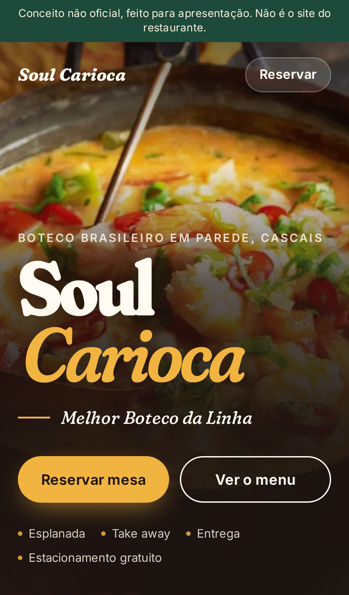

# Soul Carioca · landing de demonstração

> **Conceito não oficial, feito para apresentação. Não é o site do restaurante.**

Landing page de uma página, pensada primeiro para telemóvel, para mostrar ao
Soul Carioca (boteco brasileiro em Parede, Cascais) como poderia ser o site:
um só horário, menu com preços, reserva por WhatsApp e morada com link de mapa.
Site estático em [Astro](https://astro.build), sem analytics, sem serviços
externos e sem chaves.



## Arrancar

Precisa de Node 22.18 ou mais recente.

```bash
npm ci
npm run demo
```

Abre em <http://localhost:4321>. O `--host` também o mostra na rede local,
para abrir no telemóvel ligado ao mesmo Wi-Fi (usar o endereço "Network" que
aparece no terminal).

Outros comandos:

| Comando | O que faz |
|---|---|
| `npm run dev` | servidor de desenvolvimento com recarregamento |
| `npm run build` | gera o site estático em `dist/` |
| `npm test` | testes (precisa do build feito) |
| `npm run lint` | ESLint + `astro check` |
| `./verificar.sh` | instala, faz build, lint e testes; falha se algo falhar |
| `npm run capturas` | regenera prints e vídeo (precisa do build e do Chromium do Playwright) |

## Personalizar

Todos os dados estão em **`src/config/restaurante.ts`**: nome, mote, morada,
número de WhatsApp, mensagem da reserva, telefone, horário e menu. O que está a
`null` aparece no site como marcador discreto (tracejado, ex.: `—,— €`); o texto
`[POR CONFIRMAR: …]` fica no `title` e para leitores de ecrã.

## [POR CONFIRMAR]

Nada disto foi inventado. Antes de publicar, confirmar com o restaurante:

| Marcador | Onde aparece | Onde se muda |
|---|---|---|
| `[POR CONFIRMAR: WhatsApp]` | botão "Reservar pelo WhatsApp" (sem número, abre o WhatsApp e deixa escolher o contacto) | `whatsapp` |
| `[POR CONFIRMAR: telefone]` | rodapé, "Telefone" | `telefone` |
| `[POR CONFIRMAR: horário]` | bloco "Horário" (2 linhas: dias e horas) | `horario` |
| `[POR CONFIRMAR: preço]` | os 10 itens do menu: feijoada, moqueca de peixe e camarão, caipirinha, coxinha, pastel, dadinhos de tapioca, bitoque, pizzas, mousse de tapioca, brigadeiro | `preco` de cada item |

Também por confirmar, sem marcador visível:

- Descrições dos pratos: são as descrições habituais de cada prato, não as do
  restaurante. Sabores das pizzas.
- Se o menu tem outros pratos (só estão os referidos em avaliações públicas).
- Serviços (esplanada, take away, entrega, eventos privados, estacionamento
  gratuito na zona) e a morada: vêm de dados públicos que podem estar
  desatualizados.

## Imagens

Fotos ilustrativas do Wikimedia Commons (CC0, domínio público e CC BY-SA), não
são do restaurante. Créditos e licenças em
[`docs/CREDITOS-IMAGENS.md`](docs/CREDITOS-IMAGENS.md) e no rodapé do site.

## Prints e vídeo

- `docs/prints/`: telemóvel (hero, menu, reserva e página inteira) e desktop
  (hero e página inteira).
- `docs/video/percurso-mobile.webm`: percurso de cerca de 45 s pela página em
  telemóvel, incluindo o formulário de demonstração.

## Limites desta demo

- O formulário de reserva é uma simulação: mostra uma confirmação mas não envia
  nem guarda nada (está assinalado no próprio formulário).
- Mapa só por link (pesquisa no Google Maps), sem embed nem chave.
- Página marcada `noindex`. Não publicar sem o OK do David.

Projeto aperfeiçoado com a ajuda de IA.
